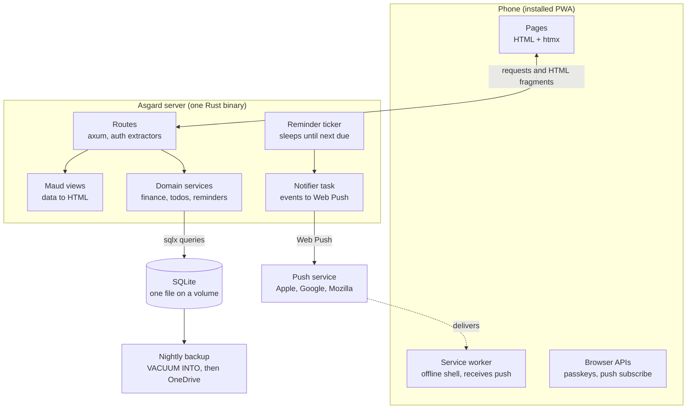

# Asgard — Technical Design

Oct 25, 2026 · Josef Jura · [Live doc](https://claude.ai/artifact/21ykAcoPrzsMNfVCbzYvFW)

Asgard is a server-first Rust web app, installable as a PWA. Product scope lives in [product-brief.md](product-brief.md).

## Stack

Asgard keeps Heimdall's stack. Most of the code will be written by Claude and reviewed by Josef, so compile-time checking matters more than it would for a human-written codebase.

| Layer | Choice | Why |
| --- | --- | --- |
| Language | Rust (edition 2024) | Safety and speed; the compiler catches mistakes before review |
| Web server | axum + tower-http | Known from Heimdall, small and explicit |
| HTML | Maud | Compile-time templates; a broken template fails `cargo build` |
| Interactivity | htmx, served from our own server | Server-first: no client state to keep in sync |
| Database | SQLite via sqlx, with compile-time-checked queries and migrations | One file, no DB server; wrong column names fail the build |
| Async | tokio | Web server and background tasks in one process |
| Passkeys | `webauthn-rs` | Mature WebAuthn implementation |
| Push | `web-push` (VAPID) | Standard Web Push without a third-party service |
| Backups | Nightly `VACUUM INTO` snapshot, picked up by the existing OneDrive job | Fits the VPS's current daily backup routine (14 kept) |

## Architecture

Pages and htmx fragments come from the routes, which call domain services and render Maud views. Reminders and other events leave as Web Push through the browsers' push services.

## Code structure and patterns

Asgard is one crate with three layers: domain logic, the web layer and views. Routes stay thin.

| Module | Holds | Rule |
| --- | --- | --- |
| `domain/` | Services and types: finance (expenses, payments, ledger), todos, reminders, quotes, members | No axum or Maud imports; unit-testable on its own |
| `web/` | Routes, extractors, forms, htmx helpers | Parse input, call a service, render a view |
| `views/` | Maud components and pages | Pure functions from data to HTML, no DB access |
| `tasks/` | Background loops (reminder ticker) | Depend on domain services only |
| `db.rs`, `config.rs` | Pool setup, migrations, env config | Config validated once at startup |

- **State:** services are built once at startup and held in an `AppState`. Routes extract what they need, with no lazy getters.
- **Auth extractors:** `Member` (any logged-in user) and `Admin`. A route's signature shows its access level, and no handler checks sessions by hand.
- **Errors:** one `AppError` that implements `IntoResponse`. Handlers return `Result<_, AppError>` and use `?`.
- **Money:** amounts stored as integer minor units (haléře), never floats. Heimdall used `REAL`.
- **Lints:** clippy pedantic + nursery, `cargo fmt` enforced in CI.

## Frontend

The server renders every page as HTML; htmx swaps fragments for interactivity. There is no client-side rendering, no npm and no bundler.

- **htmx** is vendored and served from our own server, so the offline shell works and there is no CDN dependency.
- **JavaScript** is limited to a few small hand-written ES modules for browser APIs that need it: passkey ceremonies, the push subscription, and service worker registration. That's an estimated 200 lines in total.
- **CSS** is one static, mobile-first stylesheet served with a content-hash URL for cache busting. It can be edited without recompiling.
- **PWA:** a `manifest.webmanifest`, icons, and a service worker that caches static assets and shows an offline page. Data pages always need the network.
- **Layout:** phone-first, with bottom navigation for Finance, Todos, Reminders and Quotes.

**Web components** are allowed only for an isolated widget with real client-side state, such as a chart or an amount keypad. It's written as a standalone custom element (vanilla, or Lit if it grows) that the server renders as a tag. It stays an island, never the architecture. Nothing in v1 needs one.

## Auth and sessions

Login uses passkeys only. Access is invite-only, and one-time links issued by the admin cover onboarding and recovery until an email provider is chosen.

1. **Invite:** the admin creates a member and gets a one-time link (24 h expiry). The member opens it and registers a passkey.
2. **Login:** "Sign in with passkey", using a discoverable credential, so no username field.
3. **New device:** passkeys synced by iCloud or Google work right away. Otherwise, a logged-in member adds a passkey from settings.
4. **Recovery:** the admin issues a one-time device link, which works the same way as an invite.
5. **Later:** an email magic link as self-service recovery, once a provider is chosen.

**Sessions**

- A `sessions` table stores a random 256-bit id per session. The cookie holds only that id, with `HttpOnly`, `Secure` and `SameSite=Lax`.
- Sessions are long-lived for an installed app: a 90-day sliding expiry (proposed). Logout and "sign out other devices" delete rows.
- CSRF: every non-GET request must carry an `Origin` header matching the app's URL, on top of `SameSite`.
- One-time tokens (invites, device links) are stored hashed and deleted when used.

## Notifications

Asgard sends Web Push straight to members' devices. There is no chat integration and no third-party push service beyond the browsers' own.

- **Subscriptions:** a `push_subscriptions` table (member, endpoint, keys, created). Each device opts in from settings. Subscriptions that return 404/410 are deleted.
- **Events:** reminder due, todo created or assigned to you, expense or payment added. Which events trigger a push can be configured per member later.
- **Dispatch:** domain services emit an event onto a `tokio` channel. A notifier task turns events into pushes, so a slow push never delays a request.
- **Reminder ticker:** the same design as Heimdall. It sleeps until the next due reminder and is woken by a `Notify` when reminders change. It sends the push, then marks the reminder as done.
- **iOS:** push only works when the PWA is installed to the home screen (iOS 16.4+). The settings page explains this.

## Testing and visual review

Tests are how the reviewer can trust code Claude wrote, so every feature ships with tests. The component gallery replaces Storybook without bringing in a JS toolchain.

| Layer | Tool | Covers |
| --- | --- | --- |
| Domain | Plain `#[test]` / `#[tokio::test]` | Ledger math, debt calculation, reminder scheduling, validation |
| HTTP | axum `Router` called via `tower::ServiceExt` against a temporary SQLite DB (`#[sqlx::test]`) | Routes, auth extractors, status codes, htmx fragments, CSRF checks |
| Components | `insta` HTML snapshots of Maud functions | Every markup change shows up as a reviewable diff |
| Visual | `/dev/gallery` route, in debug builds only | Every component with fixture data in all its states, at phone and desktop width |
| Visual regression (optional) | Playwright screenshots of the gallery | Added only if layouts start breaking unnoticed |

CI runs `cargo fmt --check`, `cargo clippy -- -D warnings` and `cargo test` on every push. Claude checks UI changes in the gallery before handing them over.

## Operations

Asgard runs as a single-replica Deployment in the MicroK8s cluster on our VPS, with the SQLite file on a persistent volume.

- **Build:** a multi-stage Dockerfile produces a static release binary (LTO, stripped). Pushing a `v*.*.*` git tag publishes the image to GitHub Container Registry.
- **Deploy:** Kubernetes manifests in `deploy/` (Deployment, Service, Ingress, PVC). The Deployment uses `replicas: 1` and `strategy: Recreate`, so two pods never write to the same SQLite file. Probes point at the health endpoints.
- **HTTPS:** required for passkeys, Web Push and service workers. It comes from the cluster's existing ingress, which already serves other sites. Which controller it is, and how certificates are issued, is still to be confirmed.
- **Backups:** Asgard writes a consistent nightly snapshot with `VACUUM INTO` to a backup directory. The VPS's existing daily job uploads it to OneDrive and keeps 14. Copying the live file while it's being written can produce a corrupt backup. Restoring means replacing the file and restarting the pod.
- **Health:** `/health/live` and `/health/ready` (DB check), as in Heimdall.
- **Config:** environment variables, validated at startup: `DATABASE_URL`, `PUBLIC_URL` (also used as the WebAuthn relying-party id), `VAPID_PRIVATE_KEY`, `BACKUP_DIR`, `HOST`/`PORT`, `RUST_LOG`. Secrets come from a Kubernetes Secret.
- **Data import:** a one-off CLI subcommand (`asgard import-heimdall <db>`). It converts amounts to integer haléře, maps members by name, and prints totals to compare with Heimdall.

## Alternatives considered

Every alternative either brings back client-side rendering or gives up compile-time safety, for no gain at this app's size.

| Option | Why not |
| --- | --- |
| React / Next.js | Heavy even when optimized; server components add a JS layer we don't need |
| SvelteKit, Leptos | Client state machinery an app of forms and lists doesn't need |
| Lit + Storybook as the component model | Splits the UI into Rust and JS halves; Storybook sees only the JS half. The gallery + snapshots cover the same needs. |
| Askama instead of Maud | Separate HTML files help only if non-Rust people edit the markup |
| Datastar instead of htmx | Promising, but htmx is mature and already familiar |
| Go + templ | Faster builds, but less type safety; no reason to leave Rust |
| Postgres | A DB server for a handful of users; SQLite is enough |
| MySQL 8 (existing instance on the VPS) | Tests and local development would need a running server, while SQLite gives each test a fresh file in milliseconds. A shared instance ties Asgard to the other app's upgrades and outages, and its backups would need verifying. It only pays off with several replicas or zero-downtime deploys, which v1 doesn't need. Switching later means porting dialect-specific queries: hours, not weeks. |

## Open questions

- [ ] Ingress: which controller and certificate setup does the MicroK8s cluster use? Check before the first deploy.
- [ ] Email provider for magic-link recovery: needs research. Not needed for v1.
- [x] Hosting: our VPS, MicroK8s, alongside the other websites.
- [x] Backups: the existing daily upload to OneDrive, last 14 kept.
- [x] Currency: CZK only.
- [x] Repo: a new `asgard` repo seeded from these docs; Heimdall archived after the import.
